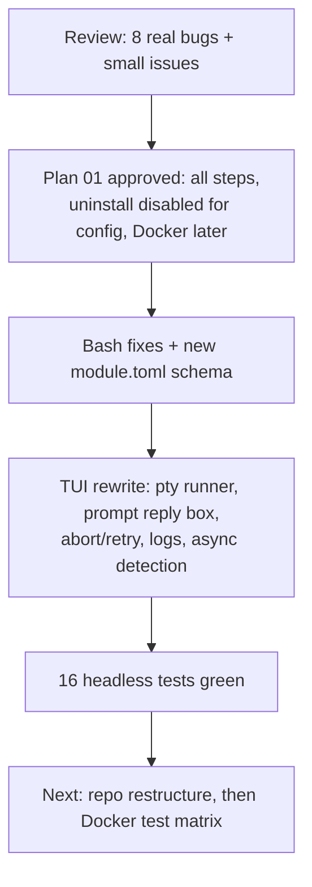

## What
- `lib/uninstall.sh` now takes package names, not a module name (the old bash-3.2 `\s` regex never matched on macOS). `pkg_uninstall` on macOS is brew-only, and on Linux it checks the package is installed before removing it.
- `install.sh`: OS guard (via common.sh), module-name validation, `--list`, `--help`, refuses to start the TUI without a TTY, pins `textual==8.2.*`, `exec uv run --no-project`.
- `uv/install.sh`: default dir is `~/.local/bin` (no sudo). Duplicate curl branches merged, `UV_NO_MODIFY_PATH=1`, verifies uv after install.
- `ssh-keygen/install.sh`: `$HOSTNAME` (a bash builtin, so `github.com` was never the default) renamed to `TARGET_HOST`/`SSH_HOST`. BSD-incompatible `sed -i` replaced. Missing email now prompts on a TTY or exits 1 (it used to exit 0).
- `multi-github/install.sh`: prompts for missing values when stdin is a TTY.
- All 44 `module.toml` files now have `kind` (app/cli/config), a `[detect]` table (commands/brew/apps/paths/paths_mac/paths_linux) and an optional `[uninstall]` table (brew/packages). They were generated by `scratchpad/gen_toml.py` (one-off, not in the repo).
- TUI:
  - `tui/modules.py`: parsing and validation; three-state detection (tool present vs config applied); extra bin dirs.
  - `tui/runner.py`: `PtyProcess` with a controlling tty, `LineSplitter` (CR/LF and progress handling), prompt and password heuristics.
  - `tui/screens.py`: main/help/confirm/run screens. The run screen streams pty output, shows a reply box for prompts (masked for passwords, never logged), confirms aborts and kills the process group, retries failed modules, writes `~/.local/state/all-configs/logs/*.log`, and shows a real progress bar.
  - `tui/app.py`: Textual workers, theme API, rescan after each run.
- Fake splash removed. The table appears at once and statuses fill in.
- Tests: `tests/tui_tests/` (16 tests, fake modules plus a temp `$HOME`). Run with `./tests/run-tui-tests.sh`. Old `tui/test_*.py` deleted.
- README keys table and module.toml docs updated.

## Key Takeaways
- sudo caches credentials per tty, so pre-authenticating with `sudo -v` does NOT carry over into a child pty. Answering prompts in the pty from a TUI input box solves sudo, `read -p` and y/N prompts generically.
- Rich `Text(style=...)` cannot use Textual `$variables`. Use real colour names.
- Never name a Screen attribute `_bindings`: it shadows Textual internals.
- Test dir must not be named `tui` (shadows the package): it is `tests/tui_tests`.

## Current State
- Branch `main`, nothing committed. Unrelated user changes are present and untouched: `tinycast/settings.json`, `pi/packages/`.
- Active experiment index: 2. Plan: `plans/01-tui-overhaul.md`. Research: `research/01-*`.
- Verified: `./tests/run-tui-tests.sh` gives 16 passed. `bash -n` passes on all edited scripts. The TUI refuses to start without a TTY (rc=1). Screenshots of main, confirm, run-prompt and run-done were reviewed (rendered with a fake root, no installs).
- Not verified: a real `sudo` prompt on macOS/Linux inside the pty, and a real brew install through the TUI.

## Issues
- `tmux/uninstall.sh` is legacy: it prompts and also removes the nvim config. It is not wired into anything now. Delete it or fold it in during the restructure.
- `external-skills`, `skills`, `multi-github` and `ssh-keygen` have no detect rules, so they show `?`.
- Description column truncation depends on a width estimate in `MainScreen._desc_width`.

## Decisions
- Stay on Textual (see research). gum, Bubble Tea and Ratatui were rejected for now.
- Uninstall is disabled for `kind = "config"` (user choice).
- Prompt answering in the pty, instead of `App.suspend()`, because it keeps the log and progress visible.
- Docker test harness deferred (user choice).

## Inferred Priority
User stated: repo restructure next ("not liking the modularity"), then Docker testing.

## Next
1. Propose the repo restructure, for example `modules/<name>/` and `lib/` helpers for symlink/backup/rc-append that are reused instead of copy-pasted (inferred design, needs user input).
2. Run a real smoke test in a terminal: `./install.sh`, select `ncdu`, Enter, y.
3. Docker: `tests/docker/` Ubuntu image with a non-root sudo user, running `./install.sh <mod>` per module.
