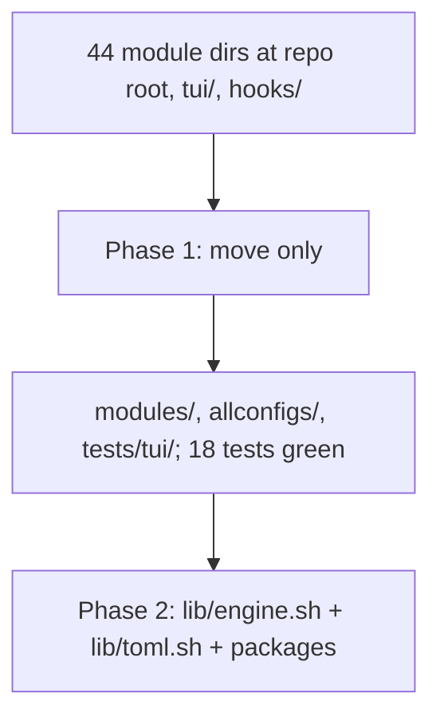

## What
- Moved all 44 module dirs into `modules/<name>/` (plain `mv`, nothing staged; untracked `modules/pi/packages` and the user's `modules/tinycast/settings.json` came along untouched).
- `hooks/turn-counter.sh` moved to `modules/statusline/turn-counter.sh`; `skills-lock.json` moved to `modules/skills/`; `demo.gif` moved to `docs/assets/`.
- Python is now the `allconfigs` package: `allconfigs/{__init__,__main__,modules,runner}.py` and `allconfigs/tui/{app,screens,widgets,theme,styles.tcss}`. Launch: `python3 -m allconfigs`.
- `load_modules(root)` globs `root/modules/*/module.toml`; `AllConfigsApp.root` = `parents[2]` of app.py.
- Module scripts: `ROOT_DIR="$(cd "$SCRIPT_DIR/../.." && pwd)"`; cross-module calls use `$ROOT_DIR/modules/<mod>/install.sh`; statusline copies `$SCRIPT_DIR/turn-counter.sh`.
- `install.sh` has `MODULES_DIR="$ROOT_DIR/modules"`; `install-minimal.sh` paths updated; `.gitignore` tmux entries prefixed with `modules/`.
- Tests moved to `tests/tui/` (fixtures build `repo/modules/<mod>`); `tests/pytest.ini` testpaths updated.
- README: new "Repo layout" section, script header template, `./modules/<mod>/install.sh` examples.

## Key Takeaways
- zsh does not word-split `$var` in `for m in $mods`; use bash for loops over lists.
- Earlier `tests/tui` name clash is gone because the package is now `allconfigs`, not `tui`.

## Current State
- Branch `main`, nothing committed. `git status` shows the moves as deletes + untracked `modules/`, `allconfigs/`.
- Verified: `./tests/run-tui-tests.sh -q` → 18 passed; `./install.sh --list` → 44; `--help` ok; `bash -n` clean on all scripts; headless real TUI loads 44 rows with real detection.
- Not run: any real installer.

## Issues
- None blocking. `modules/tmux/uninstall.sh` (legacy, dangerous) still present; delete in phase 4.

## Decisions
- `turn-counter.sh` sits next to statusline's other files instead of a lone `files/` dir; `files/` layout arrives with phase 3 links.
- Tests stay together in `tests/tui/` until phase 2 adds `tests/unit/` for the bash engine.

## Inferred Priority
- (inferred) Phase 2: `lib/toml.sh` (bash TOML subset parser) + `lib/engine.sh` with `[packages]`, tomllib-vs-toml.sh parity test, convert the 14 cask-only modules and ffmpeg/ncdu/yt-dlp/zoxide.

## Next
- Read `docs/experiments/002-tui-overhaul/plans/02-repo-restructure.md` (Decisions section).
- First command: `./tests/run-tui-tests.sh -q` to confirm green, then write `lib/toml.sh`.
- No Claude attribution in commits. Don't touch `modules/tinycast/settings.json` or `modules/pi/packages`.
