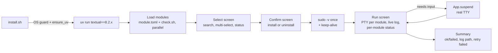

## Goal

Make the all-configs installer production-grade on **macOS and Linux only**. Fix every issue from the review, replace the fake splash, and give installs a real terminal so sudo and brew work. Framework decision: **stay on Textual** (see `research/01-res-tui-framework-choice.md`).

## Architecture changes



### 1. Module metadata: separate "tool present" from "config applied"

Extend `module.toml`:

```toml
name = "tmux"
description = "tmux config, TPM, vim nav, clipboard"
platforms = ["mac", "linux"]
package = "tmux"          # optional, used for pkg uninstall
kind = "config"           # package | app | config
needs_sudo = false        # prompts sudo -v before run
interactive = false       # run via App.suspend (e.g. gh auth, ssh-keygen)
```

- Optional `<mod>/check.sh`: exit 0 means fully applied. For example tmux checks that the binary exists **and** `~/.tmux.conf` points at the repo. If it's missing, fall back to `package` detection.
- Status becomes three-valued: `installed`, `partial` (tool present, config not applied), `-`.
- **Never block install of installed modules.** Install means (re)apply: all install scripts must be idempotent. Show "will re-apply" in the confirm screen instead of skipping silently.
- Remove the substring `.app` match. Use exact candidates only, or an explicit `app = "Visual Studio Code"` field.

### 2. Uninstall

- Fix `lib/uninstall.sh` regex: `^package[[:space:]]*=[[:space:]]*\"(.*)\"$`, which works on bash 3.2.
- Optional `<mod>/uninstall.sh`. If present, it is used (config modules remove their symlinks and restore backups). If it's absent:
  - `kind = package/app`: `pkg_uninstall "$PKG"`.
  - `kind = config`: uninstall is **disabled** in the TUI (greyed out, with a notice). It never deletes the tool.
- `pkg_uninstall` on mac: if the package is not brew-managed, fail with a clear message. Never fall through to apt/dnf checks.
- Add a **ConfirmScreen for uninstall** (red variant, lists what gets removed).

### 3. Run screen (the core fix)

- Run each script in a **PTY** (`pty.openpty()` + `asyncio` reader), not a pipe. That gives colours, line buffering, and brew/apt behaving as on a terminal. Render with `Text.from_ansi` in the `RichLog`.
- Before the run: if any selected module has `needs_sudo`, call `App.suspend()` → `sudo -v` → resume. Then run `sudo -n true` every 60s as keep-alive during the run.
- Modules with `interactive = true` run inside `with self.app.suspend():` with inherited stdio. The run screen shows "running in terminal…".
- Use a Textual **worker** (`self.run_worker(..., exclusive=True)`), not a bare `asyncio.create_task`.
- Layout: left = module list with live status (`pending/running/ok/failed`, elapsed time). Right = log for the focused module. Bottom = real `ProgressBar(total=len(modules))`, advanced per module.
- **Escape during a run** asks "Abort after current module?" instead of dismissing. Abort sends SIGTERM to the process group, then SIGKILL after 5s. Close is enabled only when finished.
- Write the full log to `~/.local/state/all-configs/logs/<timestamp>.log`.
- Summary screen: counts, failed list, log path, `r` = retry failed.
- Status refresh after a run: re-run detection (`check.sh`) for touched modules. Never assume success means installed.

### 4. Startup / splash

- Remove the fake timer progress bar. Show the table immediately with a `LoadingIndicator` in the Status column, and fill rows as detection finishes. Run `brew list` once, then `check.sh` scripts concurrently (`asyncio.gather` with a semaphore of about 8).

### 5. Main screen polish

- One source of truth for keybindings: generate the footer and help from `BINDINGS` (use Textual `Footer`).
- Keep the cursor position across filter changes.
- Status column colours: installed = green, partial = yellow, failed-last-run = red.
- Column for `kind`. Group or sort by kind optionally.
- Use the Textual theme API (`self.theme = "textual-light"` or a custom `Theme`) instead of `self.dark = False`. Keep hard-coded hex colours only through theme variables in `styles.tcss` so light and dark both work.

### 6. Bootstrap (`install.sh`, `uv/install.sh`)

- Add an OS guard in `install.sh`: Darwin/Linux only (already in `common.sh`, but also check in Python at startup).
- Pin Textual: `uv run --python 3.12 --with 'textual==8.2.*' python3 -m tui`.
- Set PATH before printing "uv installed". After install, verify `command -v uv` and fail clearly if it's missing.
- `uv/install.sh`: default `INSTALL_DIR=$HOME/.local/bin` (writable, no sudo). Merge the duplicate curl branches.
- Direct mode: validate the module name (`[[ "$mod" =~ ^[a-z0-9-]+$ ]]`).
- `install.sh --list` prints modules for scripting.

### 7. Tests (UI only now, Docker later)

- Move tests to `tests/tui/`, add a `pytest` + `pytest-asyncio` config (`asyncio_mode = auto`).
- Fixture module root with fake `install.sh` scripts (echo, `exit 1`, sleep). No dependency on what the host has installed.
- Snapshot tests via `pytest-textual-snapshot` for the main, confirm, run and summary screens.
- No writes to `/tmp`: use `tmp_path`.

## Execution order

1. Bash fixes: uninstall regex, `pkg_uninstall` mac path, `uv/install.sh` dir, `install.sh` guard and pin. Small, high value.
2. Module schema (`kind`, `needs_sudo`, `interactive`) + `check.sh` for config modules (tmux, nvim, claude, ghostty, github, codex, vscode, aliases, p10k, statusline, pi…).
3. Run screen rewrite (PTY, worker, sudo, suspend, abort, log file, summary).
4. Main screen: remove splash, async detection, Footer from bindings, theme, uninstall confirm.
5. Tests with a fixture root.
6. (Later) Docker matrix for Linux, Tart/GH Actions for macOS.

## Open decisions for the user

- Should config modules get real `uninstall.sh` scripts (remove symlinks, restore backups), or should uninstall be disabled for them?
- Is a Docker Linux matrix enough for now, with macOS verified manually or in CI?
