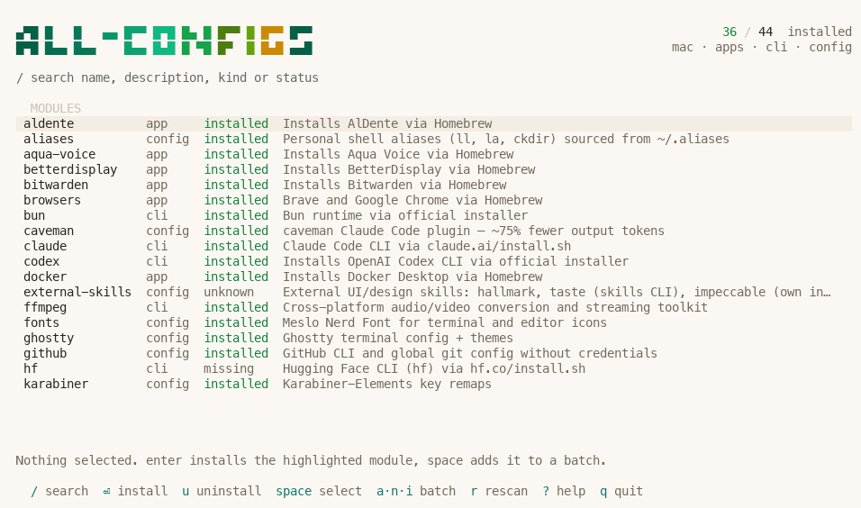
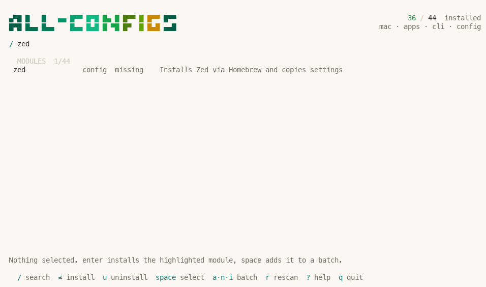
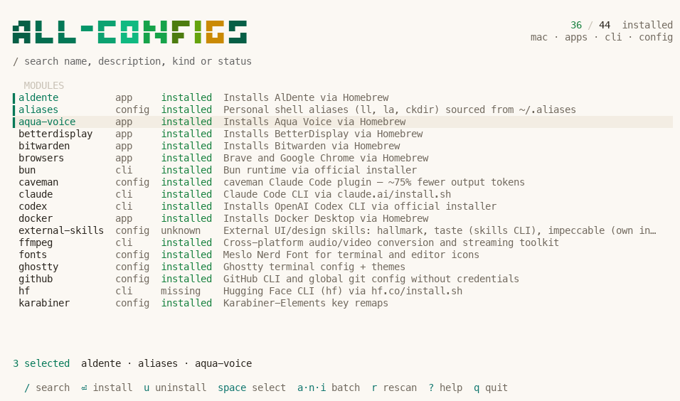
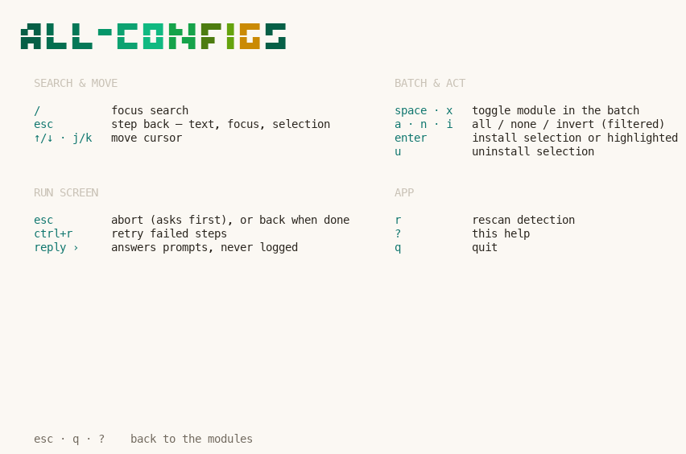
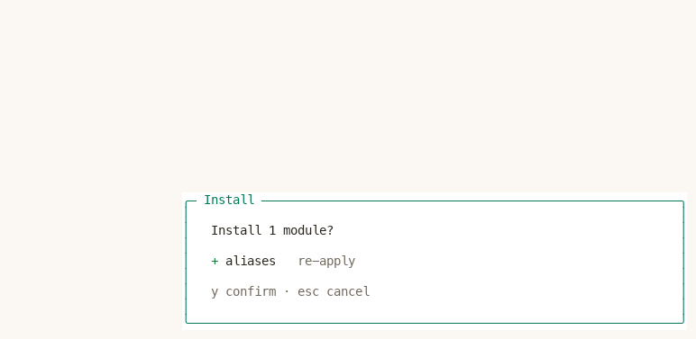
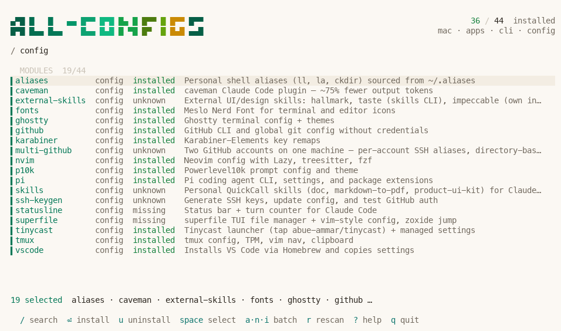
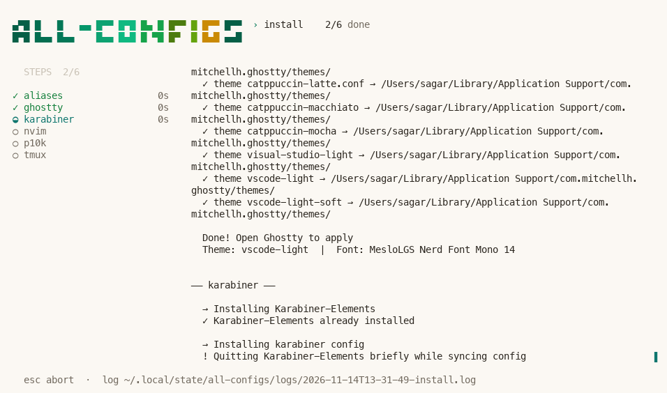
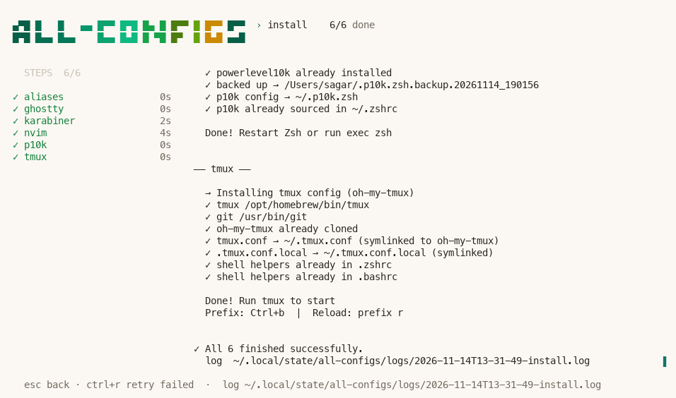

# 003 — OpenTUI experiment

Reimplement the all-configs TUI with [OpenTUI](https://opentui.com) (`@opentui/react`, Bun) alongside the existing Textual TUI, reusing the Python discovery/detection logic via an NDJSON probe.

## Status: working v0.1 (2026-11-14)

- Code: `experimental/opentui/` — run with `bun run start` from that directory.
- Bridge: `allconfigs/probe.py` (new module; Textual TUI untouched).
- 7 tests pass (`bun test`), tsc clean. Two tests are end-to-end: real module discovery and a real (idempotent) install of `aliases` through the run screen.
- Verified interactively in a real pty: search/filter, selection, help overlay, confirm dialog, live install with streamed output, log file, abort/retry plumbing, clean quit.

## Parity with the Textual TUI

Implemented: search (name/description/kind/status), esc layering (search text → search focus → selection), cursor navigation, batch select (space/a/n/i on the filtered set), install/uninstall with confirm + skipped-config notes, rescan, run screen (sequential jobs, per-job status/spinner/timing, streamed pty output with `\r` progress collapse, prompt detection + reply box, abort with confirm, ctrl+r retry, log file at `~/.local/state/all-configs/logs/`).

Not implemented (possible follow-ups): light theme + `ALL_CONFIGS_THEME`, exit code 1 on failures at quit, notifications for skipped module.toml files (currently shown as a line on the main screen), mouse support, `COLUMNS`-aware wrapping of child output.

## Screenshots

Real captures of the app running in tmux (regenerate with `python3 capture_shots.py`):

| | |
|---|---|
|  |  |
| Main screen: live detection, statuses, keybind footer | Search filter (`/`), `1/44` rows shown |
|  |  |
| Batch selection (`space`), summary bar | Help overlay (`?`) |
|  |  |
| Confirm dialog (`enter`) | Filtered batch: 6 modules selected via `a` |
|  |  |
| Run screen mid-flight: steps, streamed pty output, scrollbar | Run finished: `6/6 done`, per-job timing, log path |

## Platform notes

- Jobs run under macOS `script -q /dev/null` for a real child pty.
- Bun's pipes are sockets; `script` rejects them (`tcgetattr: Operation not supported on socket`). Solved by allocating a reply pty via `bun:ffi` (`posix_openpt`/`grantpt`/`unlockpt`/`ptsname` in `libSystem.B.dylib`) and passing the slave fd as `script`'s stdin. Linux fallback constant included but untested.
- `uv run --no-project --python 3.12` is used to invoke the probe because system python (3.9) lacks `tomllib`.

## Key OpenTUI gotchas (see also `experimental/opentui/README.md`)

- A keybinding that focuses an input must `key.preventDefault()` or the keystroke is also inserted as text.
- Punctuation key names vary by terminal protocol — match both `"slash"` and `"/"`, `"question_mark"` and `"?"`.
- `<input onInput>` gives the value; `<input onSubmit>` receives an empty event object.
- `rgba()` colors warn and fall back to magenta; use solid colors.
