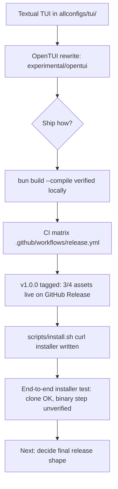

# 01 — v1.0.0 binary release shipped

## What
- Answered the core question: **yes, Bun compiles to a real standalone binary.**
  `bun build --compile src/index.tsx` produces a ~129 MB single executable
  (embedded Bun runtime + JavaScriptCore + OpenTUI's native Zig lib; the app
  code is <1 MB). Verified working standalone in a pty with
  `ALL_CONFIGS_ROOT` set.
- Shipped the release pipeline: push a `v*` tag →
  `.github/workflows/release.yml` builds 4 targets → assets attach to a
  GitHub Release. `v1.0.0` is live:
  https://github.com/quickcall-dev/all-configs/releases/tag/v1.0.0
- Assets gzip-compressed in CI (129 MB → ~45 MB download; installer gunzips).
- Wrote `scripts/install.sh` (curl | sh): clone/pull `~/.all-configs` +
  download `releases/latest/download/all-configs-tui-<os>-<arch>.gz` →
  `~/.local/bin/all-configs`. Re-running = self-update.
- Docs: `docs/RELEASING.md` (the release process), root README + TUI README
  updated. Agent-skill dirs (`.agents/`, `.claude/`, `.openhands/`,
  `skills-lock.json`) were accidentally committed once, then un-vendored and
  gitignored in `9076612`.

## Key Takeaways
- Numbers: raw binary 129 MB (104 MB local darwin-arm64 build + variation by
  platform), gzipped asset ~45–59 MB. App code <1 MB; the rest is runtime.
- `bun build --compile` Linux targets are **musl-linked**; `@opentui/core`
  picks its native package from the *runner's* libc (glibc) → CI must
  `bun add --dev @opentui/core-linux-<arch>-musl` on Linux jobs.
- `uname -m` on GitHub's arm runners says `aarch64`, not `arm64` — map both.
- Do NOT use `--frozen-lockfile` in cross-platform CI: the lockfile only
  carries the dev machine's optional native deps.
- The org denies the `macos-14` runner label (job dies in <1s, zero steps).
  `macos-15` works for darwin-arm64; `macos-13` works for darwin-x64 but the
  x64 pool is congested (job queued for a long time).
- Repo root resolution in `experimental/opentui/src/bridge.ts`:
  `$ALL_CONFIGS_ROOT` → walk up from execPath/cwd to `modules/` +
  `lib/common.sh` markers → dev layout fallback. Works from `bin/` inside the
  clone.
- The repo is **public** — the curl installer needs no auth.

## Current State
- Branch `main` at `aa75457` (all pushed). Tag `v1.0.0` points at
  `b418688`-era tree (tag was moved several times during CI debugging; the
  workflow fixes are on main and in the tag's history via retag — retagged
  last at `aa75457`'s parent chain; verify with `git rev-parse v1.0.0`).
- Release v1.0.0 assets at last check: `darwin-arm64.gz` (45 MB) ✅,
  `linux-x64.gz` (59 MB) ✅, `linux-arm64.gz` (59 MB) ✅,
  `darwin-x64.gz` — was still queued on `macos-13` (GitHub-side; attaches
  automatically when the job finishes).
- A stale uncompressed `all-configs-tui-linux-x64` (135 MB) asset from an
  earlier partial run was on the release; `gh release delete-asset` 404'd —
  check if it's still there and delete via the web UI or
  `gh api -X DELETE .../releases/assets/<id>`.
- Installer test state: sandboxed run at `/tmp/ac-install-test` cloned the
  repo fine (103 MB — includes screenshots + the brief skill-vendor commit
  history); the binary-download step never completed inside my command
  timeouts. Temp dir deleted; nothing installed on the user's machine.
- All TUI tests pass (`cd experimental/opentui && bun test`, 8 tests);
  `tsc` clean. Textual TUI archived at `archive/textual-tui/`.

## Issues
- **Binary size**: 129 MB raw per platform is the price of an embedded Bun
  runtime. gzip gets the download to ~45 MB, installed size stays 129 MB.
  Alternatives not explored: shipping source + requiring Bun (tiny, but a
  runtime dep), waiting on Bun slim compile (doesn't exist yet).
- **darwin-x64 asset missing** at last check (runner congestion, not an
  error).
- **Installer end-to-end unverified** — the only unproven link in the chain.
- Repo clone is 103 MB (git history includes the 22k-line skill-vendor
  commit `b418688` and large screenshots). Consider `--depth 1` in the
  installer or history cleanup if clone speed matters.
- `gh release delete-asset` returned 404 for the stale asset — API path
  issue, retry via `gh api`.

## Decisions
- Release shape: **tag → CI binaries → GitHub Release assets + curl
  installer**. Chosen over Homebrew tap (more infra to maintain) and
  npm/bunx (still requires the modules repo; no size win).
- gzip the assets (≈3× smaller download), installer decompresses with
  `gunzip` (present on macOS/Linux).
- Binary finds the repo at runtime (env var + marker walk-up) instead of
  baking a path at compile time — one binary artifact per platform, movable.
- Karabiner-Elements was restarted in-place so keymap changes load (user was
  informed).

## Inferred Priority
User wants to "figure out release off this next" — i.e., review this
checkpoint, decide whether the bun-compile binary is the right long-term
shape, and harden whatever remains: verify the installer end-to-end, clean
the stale release asset, decide on shallow clones / repo slimming.

## Next
1. Check the release is complete:
   `gh release view v1.0.0 --repo quickcall-dev/all-configs --json assets`
   — confirm `darwin-x64.gz` arrived; delete the stale uncompressed
   `all-configs-tui-linux-x64` asset (`gh api repos/quickcall-dev/all-configs/releases/assets/<id> -X DELETE`).
2. End-to-end installer test (sandboxed, ~2 min):
   `rm -rf /tmp/acit && ALL_CONFIGS_DIR=/tmp/acit/dir ALL_CONFIGS_BIN=/tmp/acit/bin sh scripts/install.sh`
   then run the installed binary under a pty (it needs a tty; expect the
   module list to stream in after ~5–10 s via uv). Give it 5+ minutes or run
   in the background — the clone is the slow part.
3. Decide the open sizing question: keep bun-compile binaries vs source+Bun
   install. If binaries win, consider `--depth 1` clone in `scripts/install.sh`.
4. If the release shape is approved: announce/ignore `docs/RELEASING.md` as
   the process doc; future releases are just `git tag -a vX.Y.Z && git push origin vX.Y.Z`.
5. Do NOT commit `.agents/`, `.claude/`, `.openhands/`, `skills-lock.json`
   (gitignored since `9076612`).
